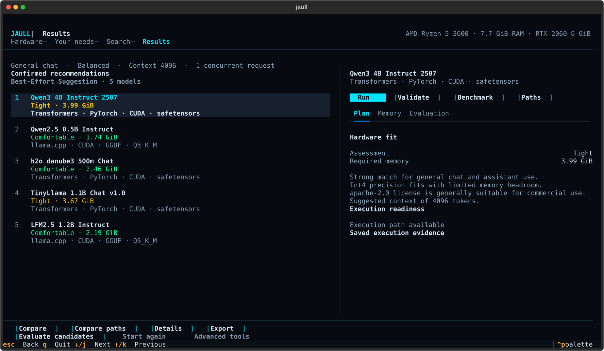

# Jaull

**From local hardware to evidence-backed LLM deployment decisions.**

[](https://codecov.io/gh/Ton-Llop/Jaull)

Jaull tells you which open language models your machine can really run, picks the exact
file and runtime for each one, and explains the order. It can then run them, benchmark them
and score them on your own hardware. No language model writes the ranking or the
explanations.



*A real search on an older desktop (Ryzen 5 3600, 7.7 GiB RAM, RTX 2060 6 GiB, WSL2):
English general chat, Balanced priority, commercial use required. Five plans, each with its
memory fit, runtime and file format.*

**One recommendation from the same search**, shortened from the exported report:

```text
2. Qwen/Qwen2.5-0.5B-Instruct-GGUF — Safer option
   Q5_K_M · llama.cpp on CUDA · fits comfortably (1.74 GiB) · apache-2.0, commercial use OK
   llama-server --model Qwen2.5-0.5B-Instruct-GGUF.Q5_K_M.gguf --ctx-size 4096 --n-gpu-layers -1

   Why this position: placement confirmed · strong fit for chat · strong runnability ·
                      weak capability (a 0.5B model) · lots of memory headroom
   Measured on this machine, this exact file:
     IFEval, 541 prompts      25.9 % (140/541)
     tg128 generation speed   median 246.1 tok/s over 6 calls (observed 218.6–271.7)
   Measured evidence did not change its position (#2 → #2).
   Warning: confidence is low; runtime overhead is a documented heuristic, not a measurement.
```

To try it: [Quick start](#quick-start). To find your way around the screens:
[What each button does](#what-each-button-does).

---

Jaull is an explainable local-AI qualification toolkit. It reads your machine, selects
candidate language models, resolves the exact artifact you would actually run, verifies it,
checks whether a local runtime and compute backend can execute it, runs it, benchmarks it,
and compares what it predicted against what really happened.

The question it is built around:

> **Can this exact model, artifact, runtime and configuration satisfy the workload we want
> to run on this infrastructure?**

A recommendation is only the beginning of that answer. Everything after it — the artifact,
the revision, the runtime, the backend, the execution, the measurement — is what turns a
plausible suggestion into a decision you can defend.

```text
predict → acquire → verify → execute → benchmark → compare → qualify → deploy
```

Jaull implements `predict → compare` today. `qualify` and `deploy` are the direction the
project is heading in; see [Where Jaull is going](#where-jaull-is-going) for what is real
and what is not.

Jaull is an active open-source engineering project developed as an undergraduate
end-of-degree project (TFG) on local-AI infrastructure. It is usable, it is tested, and it
is not finished.

---

## Quick start

Requirements: Python 3.12+ and [uv](https://docs.astral.sh/uv/).

```bash
git clone https://github.com/Ton-Llop/Jaull.git
cd Jaull
uv sync
uv run jaull ui
```

`uv sync` creates the virtual environment and installs the runtime dependencies plus the
`dev` dependency group. Pass `--no-dev` if you only want the runtime dependencies.

Optional but useful:

- an NVIDIA driver + NVML for VRAM detection (everything degrades cleanly without it);
- `vulkaninfo` for non-NVIDIA accelerator and backend detection;
- a local `llama.cpp` build (`llama-cli`, `llama-bench`) for GGUF execution and benchmarks;
- `HF_TOKEN` in the environment for gated or private repositories.

```bash
uv run jaull                             # opens the TUI when run in a terminal
uv run jaull scan                        # local hardware and compute backends
uv run jaull doctor                      # environment, runtime and readiness checks
uv run jaull inspect <repo-id-or-url>    # analyse a model repository
uv run jaull estimate <repo-id-or-url>   # memory footprint + compatibility
uv run jaull run --model <repo> --prompt "Hello"   # download, verify and execute a GGUF
```

Full option reference: [docs/cli.md](docs/cli.md).

---

## What Jaull can do today

Everything in this section exists in the code and is covered by the test suite.

**Hardware and backends.** Detects OS, CPU, RAM and storage; NVIDIA GPUs with VRAM and
driver versions through NVML; and non-NVIDIA adapters through a `vulkaninfo` probe that
records per-backend availability (CUDA / Vulkan / HIP / CPU) and flags software renderers
such as llvmpipe instead of treating them as usable accelerators. On Linux, a discrete
Vulkan device can additionally obtain physical and, when the driver exposes it, available
VRAM from DRM sysfs. That enables AMD/Vulkan planning without treating VRAM and system RAM
as one pool. Runtime execution still requires a compatible local binary, verified separately
through `llama-cli --list-devices`; Intel and Apple memory discovery remain outside this path.

**Model inspection.** Normalises any Hugging Face URL form to a `repo_id`, classifies the
repository (`transformers` / `gguf` / `diffusers` / `onnx` / `adapter` / `unknown`) and
reports files, GGUF quantization variants and configuration — downloading only small
metadata files, never weights.

**Explainable memory estimation.** Weights, KV cache, runtime overhead, device reserve and
safety margin are estimated separately, each row carrying its provenance (`exact`,
`metadata`, `derived`, `assumed`, `unknown`) and a confidence reduced by the weakest link.
For GGUF repositories without a `config.json`, the base model is resolved from card
metadata and the GGUF header is read over HTTP Range (≤ 8 MiB, streamed and abandoned once
the header is in hand) instead of downloading the file.
→ [docs/estimation.md](docs/estimation.md)

**Guided requirements and recommendation.** Six or seven plain-language questions, depending
on whether the document-context question applies — no model names, quantizations or dtypes —
become a `UserRequirements` object that records every assumption it made. Discovery queries
the Hub API, deduplicates and filters candidates, then shortlists
them for deep inspection using a coarse hardware placement hint, so GPU-resident, offload and
CPU-RAM candidates all stay in play instead of one size class taking every slot.

Ranking then runs over **execution plans**, not repositories, and produces no global score:
each plan is assessed on separate axes — task suitability, capability, hardware feasibility,
technical executability and confidence — and ordered by a lexicographic key whose axis
order is chosen by the user's priority. Measurements stored on this machine can then
reorder comparable plans (see [Measured evidence](#measured-evidence-quality-fastest-balanced)).
Hard incompatibilities remove a plan outright; a diversifier then keeps one slot per
logical model. Every reason and
warning is generated by explicit rules. **No language model is involved in ranking or in
writing the explanations.**

The wizard records model task and workload mode separately. Optional workload SLOs are
requested objectives; benchmark measurements remain separate observations.

The ranking is also **independent of what happens to be installed**: a missing `llama-cli`
changes readiness, not the Top 5, and that invariant is pinned by a test.
→ [docs/recommendation.md](docs/recommendation.md)

**Execution plans.** A recommendation is resolved into a logical model identity, the
artifact variants that represent it (GGUF quantizations, safetensors precisions) and the
concrete execution plans built from those variants — each with its runtime, backend
selection, readiness and memory prediction.

**Artifact resolution, download and verification.** Resolves a repository plus quantization
to a single-file GGUF artifact at a concrete revision, downloads it into a per-user
artifact store with path-traversal protection, and verifies file size and SHA-256 against a
sidecar (with optional full re-hashing). A known expected digest must match the
downloaded file and cannot be replaced by a conflicting local sidecar.

**Runtime and backend readiness.** Discovers local `llama.cpp` builds (explicit path,
registry, PATH, conventional build directories) and the PyTorch/Transformers environment,
probes which backends each one actually exposes, selects a compute backend for the detected
hardware, and produces an `ExecutionReadiness` preflight decision before anything is run.

**Real execution.** `jaull run` executes single-file GGUF artifacts through `llama-cli`.
When its capability probe confirms a non-CPU device, the prepared launch pins the
runtime to the reported device identifier (for example `Vulkan0` or `HIP0`) instead of
guessing from the host GPU name. The TUI additionally executes Transformers repositories
through an isolated Python worker.
Every execution produces an `ExecutionObservation` — success, duration, exit status, peak
sampled process RSS and, when NVML can attribute it to the PID, peak process VRAM — kept
strictly separate from the prediction.

**Persisted experiments.** A validation run is stored as an immutable `ExperimentRecord`
(one JSON file per experiment, with a schema version) linking the hardware profile, the
artifact, the runtime, the prediction, the preflight, the observation and the comparison.
A failed execution is still a valid experiment: failures are evidence too.

**Benchmark evidence.** llama.cpp benchmarks run through `llama-bench` under the frozen
`llama_bench_v2` protocol (pp512 prefill and tg128 generation, 5 repetitions, `-fa off`,
`-b 512 -ub 512`, f16 KV cache, threads = physical cores, the plan's own offload and device);
older `llama_bench_v1` records stay readable as references only;
Transformers benchmarks run through an isolated worker; PyTorch ROCm is represented by its
normal `cuda` device namespace and is accepted only when the runtime probe confirms HIP.
The current Transformers methodology is `transformers_isolated_inference_v3`: GPU
timings synchronize device work, and steady-state decode excludes the initial prefill.
The worker also reports model load time and time to first token. Historical v2 records
remain readable but are not current recommendation performance evidence.
Results are persisted as `BenchmarkRecord` JSON files, and
benchmarks of the same logical model can be compared as complete execution plans rather
than as disembodied numbers. Failed runs retain diagnostics but do not replace earlier
successful performance evidence.

**Optional quality diagnostics.** `jaull quality run` explicitly invokes the pinned
local GGUF/container pilot, evaluates artifacts sequentially and saves completed,
HTTP-validated records. `jaull quality compare` compares stored per-task metrics
offline and withholds comparisons when protocols differ. Execution currently needs
a trusted Jaull checkout, exact verified local GGUFs, the pinned runtime/dataset and an already-built
evaluator image; it performs no model downloads or automatic builds. Results are limited
diagnostics, not a general-quality score. A complete audited IFEval run of a plan's exact
GGUF is what the Quality and Balanced priorities may use to reorder plans (below).
The TUI exposes the same opt-in pilot, with automatic evaluator setup, in
**Results → Evaluate candidates**, **Paths → Evaluation** and **Advanced tools →
Evaluate local GGUF quality**; see [What each button does](#what-each-button-does).
→ [CLI quality pilot](docs/quality-evaluation-pilot.md#running-it)

<a id="measured-evidence-quality-fastest-balanced"></a>
**Measured evidence (Quality, Fastest, Balanced).** After the base order, stored
measurements may reorder plans, under strict limits:

| Priority | Measurement it reads | How it reorders |
|---|---|---|
| Best quality | IFEval score of the plan's exact GGUF | higher score first |
| Fast responses | median `llama_bench_v2` tg128 of at least 3 calls of the plan's own configuration | faster first, only when the observed ranges do not overlap |
| Balanced | both of the above | first when no axis is clearly worse and one is clearly better; overlapping speed lets clearly better quality decide; a real trade-off never moves |
| Lowest memory | — | no measured policy |

A measurement only counts when it *applies* to the plan: same file bytes (SHA-256), same
machine, same GPU driver/CUDA, same device and offload, same protocol. Measured plans can
only swap places with each other inside one comparable group of otherwise-equal plans
(fit, constraints, suitability, license, language); every other plan keeps its position.
With no applicable measurement the order is exactly the base order. Reports show the
policy as a separate stage (`quality_policy`, `speed_policy`, `balanced_policy`) with the
positions before and after. → [docs/recommendation.md](docs/recommendation.md)

**Prediction vs observation.** `compare_prediction` puts a `MemoryEstimate` next to an
`ExecutionObservation` and reports the signed error under a single convention
(`measured − predicted`), plus whether the compatibility verdict was a correct
success/failure or a false positive/negative. Where the methodology does not support a
comparison — VRAM attribution, or RAM under GPU offload — it says so explicitly instead of
inventing a number.
→ [docs/evidence.md](docs/evidence.md)

**Two front-ends over the same services.** A Typer CLI with stable `--json` output, and a
Textual TUI that shows the equivalent CLI command for what it just did. Both go through the
same `AdvisorService`; neither contains business logic.

---

## The workflow in the terminal

The TUI opens on a choice between a guided analysis and the individual tools:


Guided mode starts with a hardware scan. Each checklist line turns green when its probe
actually returns — there is no fake progress — and the detected profile replaces the
checklist in place when the scan finishes:


Then six or seven plain-language questions, depending on the selected task:


The best match leads, with the alternatives compressed to one line each:


From a recommendation you reach its execution paths: the artifact variants and runtimes
that could actually run it, each labelled with how much evidence stands behind it —
estimated, ready, validated or benchmarked:


Validation runs the plan for real and compares the prediction against the observation:


More screens — search, run history, failure states, the memory estimate view — in
[docs/ui.md](docs/ui.md).

> Screenshots are regenerated with `uv run python scripts/capture_screenshots.py --size 150x42`
> (headless, no network, no llama.cpp).

---

## What each button does

Nothing in the TUI downloads a model, starts a container or runs a model until you press a
button that says so, and downloads always need their own checkbox. Keys: `Esc` goes back,
`q` quits, `↑/↓` (or `j/k`) move between recommendations.

### Welcome and search

| Button | What it does |
|---|---|
| **Guided analysis** | Scans the hardware, asks the questions, searches the Hub and ranks plans. |
| **Advanced tools** | Opens the individual tools: Scan, Inspect, Estimate, Doctor and Evaluate local GGUF quality. |
| **Find models** (wizard) | Runs the search with your answers. *What matters most?* picks the priority: Best quality, Balanced, Fast responses or Lowest memory. |
| **Cancel / Retry / Start again** (search) | Stop the search, try again after an error, or go back to the questions. |

### Results (one card per recommendation)

| Button | What it does |
|---|---|
| **Run** | Opens a prompt box and generates text with this plan's exact artifact and runtime. |
| **Validate** | Runs the plan for real, measures RAM/VRAM and duration, and compares them with the prediction. Stored as an experiment. |
| **Benchmark** | Measures this plan's speed with `llama_bench_v2` (pp512 + tg128, 5 repetitions) on its own offload and device. The result is the speed evidence that *Fast responses* and *Balanced* use. |
| **Paths** | Opens the plan's execution paths (below). |

Run, Validate and Benchmark are disabled, with the reason in the tooltip, when the runtime
is missing or cannot load that artifact.

| Button (bottom row) | What it does |
|---|---|
| **Compare** | Recommendations side by side in one table. |
| **Compare paths** | The execution plans of the same model side by side (quantizations, runtimes). |
| **Details** | Every assessment axis, reason and warning behind the order. |
| **Export** | Writes the full report as JSON and Markdown. |
| **Evaluate candidates** | Opens the evaluation screen for this search (below). |
| **Start again / Advanced tools** | New search, or the individual tools. |

### Paths

The **Plan** tab shows warnings and the exact command. The **Evaluation** tab shows
published model scores (references only) and what was measured on this exact artifact;
**Evaluate quality** opens the evaluation screen for this single plan. **Run**, **Validate**
and **Benchmark** work as on the results card. **Recheck runtime** probes llama.cpp again
after you install or rebuild it.

### Evaluate candidates

The suite selector at the top chooses what to measure. When you come from a search, it
starts on the suite that matches its priority:

| Suite | Measures | Needs | Time per model |
|---|---|---|---|
| **IFEval** (Best quality) | Instruction following, 541 prompts | Docker, evaluator image, dataset | ~25 min |
| **Speed** (Fast responses) | `llama_bench_v2` tg128 / pp512, the calls still missing up to 3 | Only local llama.cpp | up to ~5 min |
| **Balanced** | IFEval, then speed, on the same GGUFs | Both | ~25 min |
| **HellaSwag** (3 or 100 samples) | Pipeline smoke test / limited diagnostic | Docker | minutes |

- **Candidates** tab: the readiness panel (green when the evaluator, dataset and runtime
  are ready), the proposed GGUFs (up to three, from the whole inspected search pool, not
  only the top five) with download sizes, and a badge per model. A model that already has
  an applicable stored result is marked as such and starts unchecked, so it is not run
  again unless you tick it; uncheck any model you do not want.
- **Settings** tab: dataset location, the two download permissions (dataset, models) and,
  collapsed, the server/Docker/output overrides. They are filled in automatically.
- **Results** tab: stored and new results side by side (score per task, tg128/pp512 per
  model; the best value is highlighted only when the results are comparable), the run
  report, and per-plan notes on why a result does or does not apply.

| Button | What it does |
|---|---|
| **Prepare evaluator** | Checks and sets up the pinned llama-server, dataset and Docker image. Not needed for Speed. |
| **Start evaluation** | Runs the checked models one after another. Identical repeat runs count as one result. |
| **Cancel** | Stops after the current step; finished results are kept. |
| **Recompare this search with stored quality** | Re-ranks the saved search pool with everything stored now and shows which plans *would* move and why. Proposal only: the results screen does not change; run a new search to apply it. |
| **Free disk space** | Lists downloaded models and evaluation output folders with their size; tick and **Delete selected**. Stored results, benchmarks and experiments are kept; a deleted model is downloaded again if needed. |

### Typical loop

1. Search with the priority you care about.
2. **Evaluate candidates** → **Start evaluation** (or **Benchmark** a single plan).
3. **Recompare** to see what the new evidence would change, or search again to apply it.
4. **Free disk space** when the models are no longer needed.

---

## Where Jaull is going

The workload contract is available; qualification and capacity measurement are not.
The sections below describe the intended direction, not a current verdict.

### Workload-aware qualification

Jaull can record task separately from interactive or batch mode, plus context,
concurrent users and optional input/output lengths, minimum generation throughput and
maximum time-to-first-token. These are requested objectives, not measured results or a
qualification verdict. The wizard only asks for task and mode; SLOs are optional API data.

### Capacity and load experiments

Running real load rather than single prompts: concurrency sweeps, throughput and TTFT under
load, RAM and VRAM behaviour, degradation curves, and an estimate of the concurrency a
machine can actually sustain.

The next planned step is small: one loaded llama.cpp server with 1, 2 and 4
simultaneous users. Loading and warm-up stay separate from request measurements.
Multiple model processes would measure a different workload. This experiment is
not implemented yet; see [the current status](STATUS.md).

### Deployment qualification

Turning the accumulated evidence into an explicit verdict:

```text
QUALIFIED
CONDITIONALLY QUALIFIED
NOT QUALIFIED
```

backed by the experiments and benchmarks that produced it, and by the policy gates it was
evaluated against.

### Reproducible deployment

A validated configuration should be pinnable to something like a `jaull.lock`: exact
repository, revision, artifact and SHA-256; runtime, version and backend; context and
runtime parameters; the hardware it was validated on; the measurements obtained; and the
workload it was qualified for — and then exportable as a reproducible deployment.

### How the system evolves

```text
implemented  hardware → requirements → candidates → prediction → artifact → verification
             → runtime/backend readiness → execution → benchmark → prediction vs observation
             + workload profile and optional SLO data (not measured qualification)

planned      load & capacity experiments → sustainable concurrency
             → deployment qualification → jaull.lock → reproducible deployment
```

---

## Architecture

Jaull is a modular Python monolith. There are no workers, no containers and no remote
executors — the boundaries exist so those can be added later without a rewrite.

The dependency direction is one-way:

```text
Presentation    cli/ · tui/ · presentation/ · reporting/ · diagnostics/
      ↓
Advisor         advisor/          the single facade both front-ends talk to
      ↓
Application     application/ · workflow/     use cases and guided orchestration
      ↓
Domain / Ports  domain/ · ports/  frozen models, pure heuristics, boundary protocols
      ↑
Adapters        adapters/ and the infrastructure packages, composed by bootstrap/
```

```text
src/jaull/
├── domain/           # frozen Pydantic models, enums, policies, pure heuristics
├── ports/            # boundary protocols for replaceable infrastructure
├── application/      # use cases: requirements, model references, variant discovery,
│                     #   recommendation service, policies, execution-plan assembly
├── adapters/         # concrete implementations behind the ports (model-analysis cache)
├── bootstrap/        # production composition root (`ServiceContainer`)
├── advisor/          # application facade used by both front-ends
├── hardware/         # CPU/RAM/storage probes, NVML, Vulkan backend detection
├── huggingface/      # Hub client, URL parser, repository classifier, artifact resolver
├── analyzers/        # per-repository-type analyzers behind a Protocol
├── metadata/         # GGUF header reader over HTTP Range, base-model resolver, config merge
├── estimator/        # weights, KV cache, overhead, compatibility, policies
├── discovery/        # Hub search, query building, filtering, enrichment, series grouping
├── recommendation/   # plan assessment, ranking, diversity, tiers, explanations
├── execution_plans/  # logical model identity and pure execution-plan construction
├── workflow/         # guided-run orchestrator, progress/state, per-run cache
├── artifacts/        # artifact resolution, download, storage layout, SHA-256 verification
├── runtime/          # runtime discovery, capability probes, backend selection, runners
├── execution/        # process execution contracts + host backend
├── experiments/      # experiment runner and JSON record store
├── benchmarks/       # benchmark matrix runner and JSON record store
├── evaluation/       # prediction vs observation, and benchmark vs benchmark, comparison
├── observability/    # performance telemetry
├── reporting/        # JSON + Markdown serialisation
├── presentation/     # Rich rendering
├── diagnostics/      # environment, runtime and readiness checks (`doctor`)
├── cli/              # thin Typer commands
└── tui/              # Textual screens and widgets
```

Recommendation policy, requirements normalisation, budgets and variant discovery live in
`application/`; telemetry lives in `observability/`; service construction lives in
`bootstrap/`. `workflow/` contains the guided-run orchestrator, progress and state DTOs, and
the per-run memoisation cache. Old Python import paths for moved modules have been removed.
`execution_plans/` is likewise reduced to logical model identity and pure plan construction;
anything that needs recommendation DTOs, search or caching lives in `application/`.

The boundaries enforced by `tests/test_architecture_dependencies.py`:

- `domain/` imports nothing from the layers above it, and no infrastructure library.
- `application/` never imports adapters, presentation, advisor, `workflow/` or Hugging Face
  clients — it depends on domain models and ports.
- `ports/` never imports adapters or presentation.
- `execution_plans/` never imports `workflow/` or `recommendation/`.
- `recommendation/` never imports `workflow/`, the advisor or a front-end.
- `presentation/` and TUI screens never import Hugging Face adapters.

That test scans imports with `ast`; its exception list is exact and currently empty. The
complete layer map and additional convention checks live in
[ARCHITECTURE.md](ARCHITECTURE.md).

Beyond the import graph:

- `application/`, `workflow/`, `discovery/` and `recommendation/` are pure Python — the whole
  guided pipeline runs, and is tested, without a terminal.
- Prediction (`MemoryEstimate`), observation (`ExecutionObservation`) and their comparison
  (`PredictionComparison`) are three separate objects. Measurement never edits a prediction.
- Every external dependency hides behind a `Protocol`, so tests inject fakes.
- Every weight, threshold, budget and license rule lives in a `policies.py` module.

Layer diagram, current package map and dependency rules: [ARCHITECTURE.md](ARCHITECTURE.md).

---

## Roadmap

Implemented and covered by tests:

- [x] Hardware discovery (CPU, RAM, storage, NVML, Vulkan backend probe)
- [x] Model inspection and repository classification
- [x] Explainable memory estimation with per-component provenance
- [x] Base-model resolution and GGUF header enrichment over HTTP Range
- [x] Guided requirements and explainable recommendation
- [x] Execution plans over artifact variants
- [x] Artifact resolution, download and SHA-256 verification (single-file GGUF)
- [x] Runtime discovery, capability probes and backend selection
- [x] Execution readiness preflight
- [x] Real execution (llama.cpp `llama-cli`; Transformers through an isolated worker in the TUI)
- [x] Persisted experiment records
- [x] Benchmark evidence (`llama-bench`, Transformers worker) with persisted records
- [x] Prediction vs observation comparison (RAM on CPU-only runs; VRAM against NVML or, where
      the driver attributes nothing, llama.cpp's own buffer report, with a per-component
      breakdown when the placement can be verified)
- [x] Benchmark comparison across execution plans of the same logical model
- [x] IFEval quality evaluation of exact GGUFs, with automatic evaluator setup
- [x] Frozen `llama_bench_v2` speed protocol with plan-exact applicability
- [x] Measured Quality, Fastest and Balanced policies over the base ranking

Not implemented:

- [x] Minimal workload / optional throughput and TTFT objective contract (no qualification)
- [ ] Concurrent load experiments
- [ ] Capacity curves
- [ ] Sustainable concurrency estimation
- [ ] Deployment qualification verdict
- [ ] Policy-aware qualification gates
- [ ] Reproducible deployment manifest (`jaull.lock`)
- [ ] Deployment export
- [ ] Multipart GGUF and Transformers artifacts in the CLI `run` path
- [ ] Runtime-exact placement point prediction under partial offload (the host/device
      estimate and component split already exist)
- [ ] Non-NVIDIA VRAM in the memory model beyond Linux DRM-backed discrete Vulkan devices
  (Intel, Apple Silicon and platforms without DRM VRAM telemetry)
- [ ] Remote executor
- [ ] Shared organisational deployment workflow

Vulkan and ROCm/HIP support is currently experimental: backend detection and runtime
readiness are implemented, but AMD hardware validation is still required before treating
the results as production-qualified. Vulkan is currently a llama.cpp/GGUF path; it is not
presented as a Transformers backend.

---

## Documentation

Start with [STATUS.md](STATUS.md) for what works and what comes next, or
[Jaull explained simply](docs/explicaciopatontos.md) for a Spanish introduction.
The references below describe the current implementation.

| Document | Contents | Language |
|---|---|---|
| [docs/cli.md](docs/cli.md) | Command and option reference | English |
| [ARCHITECTURE.md](ARCHITECTURE.md) | Current layers, dependency rules, `AdvisorService` | English |
| [docs/estimation.md](docs/estimation.md) | Memory model, GGUF enrichment, compatibility | English |
| [docs/recommendation.md](docs/recommendation.md) | Guided mode, discovery, scoring, licenses | English |
| [docs/evidence.md](docs/evidence.md) | Artifacts, runtimes, execution, experiments, benchmarks | English |
| [docs/experimental-validation.md](docs/experimental-validation.md) | Reproducible cross-machine validation procedure | English |
| [docs/limitations.md](docs/limitations.md) | What Jaull deliberately does not do | English |
| [docs/ui.md](docs/ui.md) | TUI screen gallery | English |
| [docs/llamacpp.md](docs/llamacpp.md) | Building and wiring up llama.cpp | English |
| [validation/README.md](validation/README.md) | Index of retained experimental evidence | English |
| [scripts/README.md](scripts/README.md) | Manual script catalogue and effects | English |

TFG material is separate from operating instructions:
[glossary](docs/Glossari.md), [development log](docs/JAULL_DEVLOG.md), and the dated
[workflow walkthrough](docs/history/workflow-2026-09-28.md) and
[technical audit](docs/history/technical-audit-2026-09-28.md).

Some documents are in Catalan or Spanish because they belong to the academic project this
tool grew out of. Everything written for contributors is in English.

---

## Limitations

The short version — the full list is in [docs/limitations.md](docs/limitations.md):

- Recommendation and estimation never download weights or run inference. Only `run`,
  validation and benchmarking do, and only when you ask for them.
- Memory-based compatibility reads NVML for NVIDIA and, for other vendors, Linux DRM sysfs
  for the Vulkan-detected device — in practice discrete AMD on an amdgpu-style driver.
  Windows AMD, Intel and Apple accelerators are still detected and their backends probed,
  but their VRAM does not enter the memory model.
- Vulkan and HIP/ROCm execution are implemented but not validated on real hardware.
- The CLI `run` path is limited to single-file GGUF artifacts.
- KV cache estimation assumes MHA/GQA with `sliding_window` as the only refinement; MoE,
  MLA and multimodal composites return `unknown` rather than a fabricated number.
- Runtime overhead, device reserve and safety margin are documented heuristics tagged
  `ASSUMED`. Per-block offloading *is* modelled, but as a runtime-agnostic placement, not as
  a measured runtime layer cost — `gpu_transformer_blocks` is not the same unit as
  llama.cpp's `--n-gpu-layers`.
- Benchmarks measure single-process throughput. There is no load model, no concurrency
  sweep and no capacity curve yet.
- No estimate substitutes for a real benchmark. That is the entire point of the second half
  of the pipeline.

---

## Contributing

Jaull is under active development and contributions are welcome — bug reports, tests,
runtime integrations, benchmark methodology, documentation and UX fixes.

**The most valuable thing you can contribute is a run on hardware we do not have.** Jaull
makes claims about hardware detection, backend availability, runtime compatibility and
memory behaviour, and those claims have only been exercised on a narrow set of machines. An
AMD, Intel, Apple Silicon or CPU-only report — even one that only says "detection got this
wrong" — is directly useful.

See [CONTRIBUTING.md](CONTRIBUTING.md) for how to set up the environment, run the checks and
open a pull request, and [SECURITY.md](SECURITY.md) for reporting security issues.

---

## License

MIT. See [LICENSE](LICENSE).

License information reported for models comes from their metadata and is **not legal
advice**. Check a model's license yourself before commercial use.
